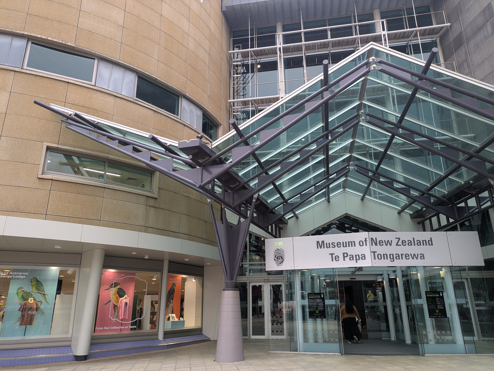
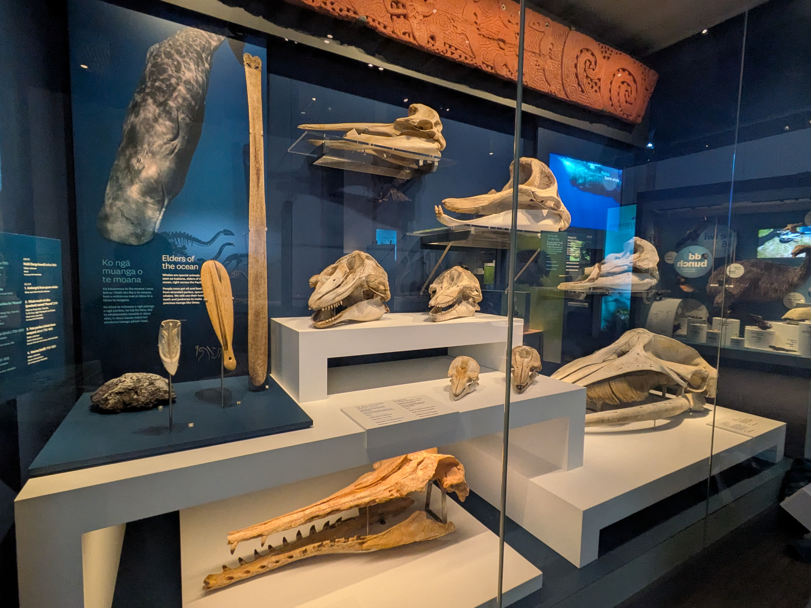
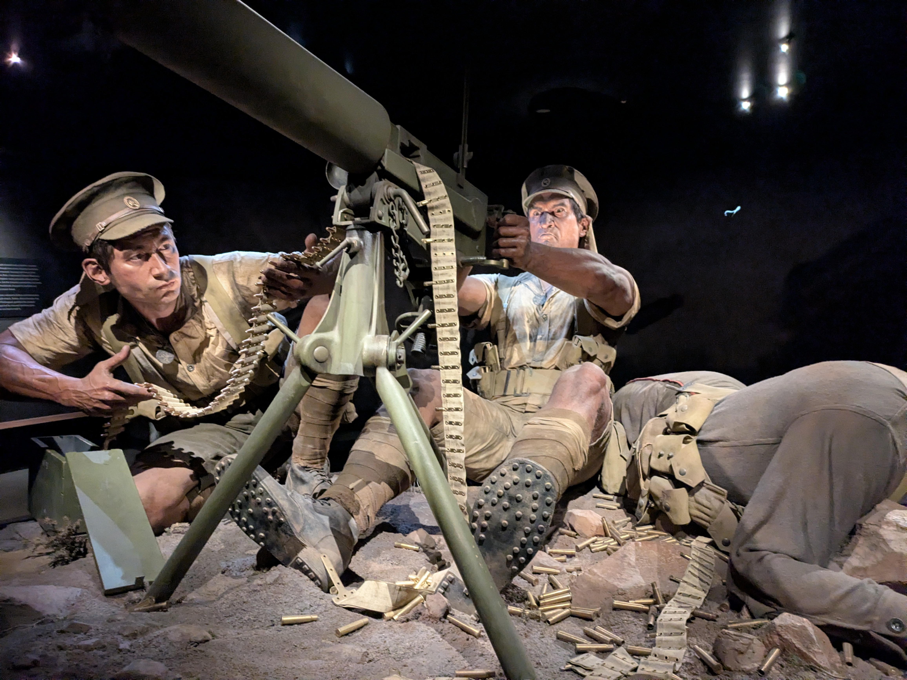
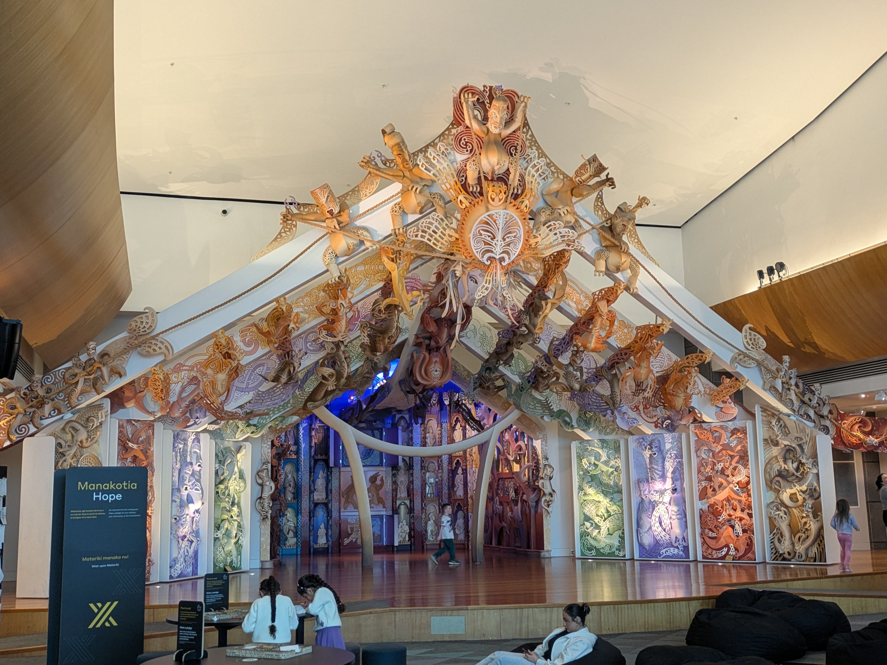

## English_Practice

I wrote the article about my roadtrip from Okarito to Picton before. I finished writing about my roadtrip in South Island so I am going to do it in North Island.

It is a museum in Wellington called Te Papa. I have already written about Wellington before.

### Te Papa Tongarewa

This is a national museum in Wellington. It has nature, history, Maori culture, art areas.

### Te Papa Tongarewa

I often see mountain and lake in my roadtrip but I think knowing about land's animal and history are also good.

### Te Taiao | Nature

Firstly, I saw fossiles and specimenes in the nature area. Moreover, I saw the volcano of exhibition. There is difference between Japanese one and New Zealand one. For example, New Zealand one has exhibition can be moved. In my opinio, that is fun for children.

### Te Papa | War

Secondly, I saw the war area in it. This area is the story of World Wor I. There are big figures which its face reflect the horrors of war clearly. I wrote my wish to the flower of paper and saw the scope from solid wall.

### Te Papa | Maori

Finally, this is Maori's exhibition. It is Maori's house with decoration. This area is exhibit and refresh area so that I saw it slowly. Farthermore, there are oal, jade of acsesary and something like that.

### 感想

I looked a lot of exhibition there. I was interested in World War I. If you have a Working Holiday Visa, you can enter this museum for free. See you later.

## 日本語版

[前回](/posts/2026/09/roadtrip-okarito-hokitika-picton/)はOkaritoからPictonまでの旅について書きました。南島のロードトリップの記事が一区切りついたので、今回から北島について書いていこうと思います。

まずはWellingtonの博物館についてですね。以前も[Wellingtonで町を散策した話](/posts/2025/08/road-trip-taupo-palmerston-north-wellington/)を書きましたが、今回は博物館の展示を中心に紹介していきます。

### Te Papa Tongarewa

Wellingtonにある[Te Papa Tongarewa](https://www.tepapa.govt.nz/te-papa-celebrates-colossal-squid-s-100th-birthday)は、ニュージーランドの国立博物館です。自然や歴史、マオリ文化、美術など、いろんな分野を扱っています。

ロードトリップでは湖や山といった景色を見ることが多いですが、その土地の生き物や歴史を知るのも旅の楽しみの一つですね。以前Taupoでも博物館について書いたので、今回はWellingtonの展示を紹介してみます。

### Te Taiao | Nature

私が初めに見たのは自然館の方で化石や標本がありました。それ以外にも火山に関する展示もありあました。日本にある博物館と少し違うなと思ったのは触ったり動かすものも多かったです。子供達もたくさん来るので実際に動かせるものがあったほうが楽しめると思いますね。

### Te Papa | War

それから別の場所では戦争に関するフロアがありました。これは第一次世界大戦の話になります。いろんな場所に大きいフィギュアが配置されており、その顔が戦争の悲惨さを鮮明に反映させています。花に祈りを書いたり、土嚢から銃のスコープを見たりと色んな体験をすることができます。

### Te Papa | Maori

最後にMaoriに関する展示物ですね。これはマオリの家に派手な装飾をしたものになってます。展示スペース兼休憩エリアとなってるため、まったりとしながら厳かな展示を見ることができます。それ以外にも当時使われていたオールやヒスイのアクセサリーなど様々なものが展示されています。

### 感想

ここの展示物もいろんなものを見ることができました。特に戦争関係はあまり見ることができなかったので新鮮でした。一つよい情報としてはワーホリビザを持っている人は無料で入ることができますので、ぜひ行ってみてください。ではでは。

## AI採点

### 評価の前提と推定Band

**今回の英語の目安はBand 5.0〜5.5です。** 展示を巡った順序と記事の主題は理解できます。一方、単複・冠詞・関係代名詞・語の組み合わせ・スペルの誤りが繰り返され、細部では日本語を読まないと意図を判断しづらい箇所があります。

評価は[IELTS公式のWriting Band Descriptors](https://ielts.org/cdn/ielts-guides/ielts-writing-band-descriptors.pdf)を参考にしています。ただし、今回は試験の設問に対する答案ではなく旅行ブログの翻訳なので、Task Achievement / Task Responseは正式には評価できません。日本語との対応は「翻訳の正確さ」として別に確認します。この推定は公式スコアではなく、誤り一つにつき一定の点数を引く採点でもありません。

| 評価項目 | 推定Band | この英文での根拠 |
| --- | --- | --- |
| Task Achievement / Task Response | 評価対象外 | 試験の設問がないため、要求への回答や論点の展開を判定できない |
| Coherence & Cohesion：構成・つながり | 6 | 自然・戦争・マオリ文化という順序は明確。ただし見出しの重複、曖昧な指示語、説明のつながりの弱さがある |
| Lexical Resource：語彙 | 5 | 主題を表す語は使えているが、スペルミスと不自然な語の組み合わせが多く、意味の精度が低い |
| Grammatical Range & Accuracy：文法 | 5 | 単純な文には正しいものもあるが、複雑な文になると一致・修飾・節の接続に誤りが生じる |
| **英語表現の総合目安** | **5.0〜5.5** | 上記3項目からの学習用の目安。正式な4項目の平均やWriting全体のスコアではない |

翻訳の大意は伝わっていますが、「日本の展示との違い」「展示を見ながら休める空間」「戦争展示が新鮮だった理由」が十分に訳せていません。以下では、**文法・語彙の誤り／より自然な表現／日本語との意味のずれ**を区別して指摘します。自然にする提案すべてが、単独で減点される誤りというわけではありません。

### 全文の添削：導入

#### 1. I wrote the article about my roadtrip from Okarito to Picton before.

- **表記：** `roadtrip` → `road trip`。標準的な表記は2語です。本文にある3か所すべてを修正します。
- **冠詞・文脈：** `the article` は特定の記事を指すなら可能です。ただ、読者への導入としては `In my previous post` とすると、前回の記事だと明確になります。ブログでは `post` も自然です。
- **自然さ：** 文末の `before` は文法的には問題ありませんが、「以前」より「前回」を明示するほうが日本語に忠実です。

**修正例：** In my previous post, I wrote about my road trip from Okarito to Picton.

#### 2. I finished writing about my roadtrip in South Island so I am going to do it in North Island.

- **冠詞：** `in South Island / in North Island` → `on the South Island / on the North Island`。この地名には通常 `the` を付け、島での旅には `on` が自然です。
- **指示語：** `do it` では「執筆する」「ロードトリップをする」のどちらか曖昧です。日本語の「北島について書く」を `write about my travels on the North Island` と明示します。
- **意味：** `I finished writing` 自体は正しい過去形です。ただ「書き終えて、今から次を扱う」という現在とのつながりには `Now that I have finished ...` がよく合います。現在完了にしないことだけを誤りとはしません。
- **句読法：** 元の文のように `so` で独立節をつなぐ場合は、その前にコンマを置くと読みやすくなります。

**修正例：** Now that I have finished writing about my South Island road trip, I am going to cover my travels on the North Island.

#### 3. It is a museum in Wellington called Te Papa.

- **構成：** `It` が何を指すのか、この時点では明確ではありません。直前の旅の話から、今回扱う博物館へつなぐ必要があります。
- **翻訳：** 日本語の「まずは博物館について」を、記事の主題として表すと自然です。

**修正例：** This time, I will focus on Te Papa, a museum in Wellington.

#### 4. I have already written about Wellington before.

- **文法：** この文は文法的に成立しています。
- **簡潔さ：** `already` と `before` は意味が重なるため、どちらか一つで十分です。
- **省略：** 「町を散策したこと」と「今回は展示を中心に紹介すること」が抜けています。

**修正例：** I have written about exploring Wellington before, but this post will focus on the museum's exhibitions.

### 全文の添削：博物館の紹介

#### 5. This is a national museum in Wellington.

- **文法：** `a national museum` は「国立博物館の一つ」という意味で文法的には正しいです。
- **意味の精度：** 日本語の「ニュージーランドの国立博物館」を明確にするには `New Zealand's national museum` が適切です。
- **指示語：** `This` でも前後から理解できますが、施設名を主語にすると独立した紹介文として読みやすくなります。

**修正例：** Te Papa Tongarewa, located in Wellington, is New Zealand's national museum.

#### 6. It has nature, history, Maori culture, art areas.

- **並列：** 最後の項目の前に `and` が必要です。
- **語彙：** `nature, history ... areas` は関係が読み取りづらい表現です。「各分野を扱う展示」なら `exhibitions covering ...` とします。
- **表記：** `Maori` はマクロンを省いた表記として理解できますが、ニュージーランドの文化を紹介する記事では `Māori` に統一すると適切です。マクロンがないだけで重大な文法ミスになるわけではありません。

**修正例：** Its exhibitions cover natural history, New Zealand history, Māori culture, and art.

#### 7. I often see mountain and lake in my roadtrip but I think knowing about land's animal and history are also good.

- **可算名詞：** `mountain and lake` は単数なのに限定詞がありません。一般的な複数の景色なら `mountains and lakes` とします。
- **前置詞：** `in my roadtrip` → `on my road trips`。旅の一般的な傾向なので複数形が自然です。特定の一度の旅なら `on my road trip` でも構いません。
- **語彙：** `knowing about` は知っている状態を指します。「旅先で知る・学ぶ」なら `learning about` が合います。
- **所有格・単複：** `land's animal` は意味も数も不適切です。`the local wildlife` や `the animals of the region` とします。`wildlife` は不可算名詞です。
- **主語と動詞：** `knowing about ...` 全体が動名詞句の主語なので、述語は `are` ではなく `is` です。後ろに `animals and history` が並んでも、主語の中心は「知ること」です。
- **意味：** `also good` では「旅の楽しみの一つ」が弱くなります。`part of the enjoyment of travelling` などで具体化できます。
- **省略：** 以前Taupoの博物館について書いたことも抜けています。

**修正例：** Although my road trips often involve admiring mountains and lakes, learning about the local wildlife and history is also part of the enjoyment of travelling.

**省略部分の補足：** I previously wrote about the museum in Taupo, so this time I will introduce some of the exhibitions in Wellington.

### 全文の添削：自然の展示

#### 8. Firstly, I saw fossiles and specimenes in the nature area.

- **スペル：** `fossiles` → `fossils`、`specimenes` → `specimens`。
- **自然さ：** `Firstly` は正しいですが、旅行記では `My first stop was ...` が訪問の流れを自然に示します。
- **語彙：** `nature area` でも理解できます。展示の名称である `Te Taiao | Nature` を使うと、どのエリアか明確です。
- **動詞：** `saw` は誤りではありません。展示を見て回った意味では `looked at` も使えます。

**修正例：** My first stop was Te Taiao | Nature, where I looked at fossils and specimens.

#### 9. Moreover, I saw the volcano of exhibition.

- **語順・前置詞：** `the volcano of exhibition` では、展示と火山の関係が逆になっています。`an exhibition about volcanoes`、または個々の展示なら `displays about volcanoes` です。
- **冠詞・単複：** 初めて紹介する一つの展示なら `an exhibition`、複数なら `displays`。特定されていないのに `the` を付ける必要はありません。
- **自然さ：** `Moreover` は文法的には正しいですが、ここでは単に別の展示もあったので `There were also ...` で十分です。

**修正例：** There were also displays about volcanoes.

#### 10. There is difference between Japanese one and New Zealand one.

- **冠詞：** `difference` を一つの相違点として使うなら `a difference` が必要です。
- **指示語：** `Japanese one / New Zealand one` は、博物館なのか火山なのか展示なのか不明確です。この文脈では、直前の「火山」を指しているようにも読めます。
- **限定詞：** 単数の `one` を使うなら `the Japanese one` などが必要ですが、ここでは対象そのものを書いたほうが正確です。
- **時制・範囲：** 現在形で一般的な違いを述べること自体は可能です。ただ、日本語は「私が違いを感じた」という体験なので、`I noticed ...` とし、国全体への断定を避けると忠実になります。

**修正例：** One difference I noticed compared with museums in Japan was the number of hands-on displays.

#### 11. For example, New Zealand one has exhibition can be moved.

- **主語：** `New Zealand one` は対象と限定詞が不明確です。今回は `Te Papa` や `the museum` で十分です。
- **可算名詞：** `exhibition` を単数で使うなら冠詞が必要です。ただし、この内容には個々の展示物を表す `displays` が合います。
- **節の接続：** `has exhibition can be moved` は、名詞と後ろの述語をつなぐ関係代名詞がありません。構造としては `has exhibits that can be moved` です。
- **意味：** `can be moved` だけだと「展示物を移設できる」という意味にもなります。日本語の「触ったり動かしたりできる」は `visitors can touch and operate` や `hands-on displays` が適切です。
- **接続：** 前の文を修正例のように具体化した場合、この文は `There were many ...` と補足できます。国ごとの単純な区分にしないほうが、実体験に忠実です。

**修正例：** There were many displays that visitors could touch and operate themselves.

#### 12. In my opinio, that is fun for children.

- **スペル：** `opinio` → `opinion`。
- **指示語：** `that` だけでは何が楽しいか曖昧です。`these interactive displays` などで対象を明確にします。
- **文法：** `fun` はこの位置で使えるため、誤りではありません。
- **省略：** 「子供がたくさん来るので」という理由が抜けています。
- **意味：** 日本語は「そのほうが楽しめると思う」という考えなので、`I think ... make the experience more enjoyable` とすると対応がよくなります。

**修正例：** Since many children visit the museum, I think these interactive displays make the experience more enjoyable for them.

### 全文の添削：戦争の展示

#### 13. Secondly, I saw the war area in it.

- **自然さ：** `Secondly` は正しいですが、訪問順なら `Next` が自然です。
- **語彙：** `war area` は戦闘地域のようにも聞こえます。展示なら `an exhibition about the war` などを使います。
- **指示語：** `in it` は博物館を指していると思われますが、不要です。前後から場所が明らかです。

**修正例：** Next, I visited an exhibition about the First World War in another part of the museum.

#### 14. This area is the story of World Wor I.

- **スペル：** `World Wor I` → `World War I`。
- **語の組み合わせ：** 展示エリアそのものが「物語である」という `is the story` は不自然です。`tells the story of ...`、`focuses on ...`、`explores ...` を使います。
- **表記：** `World War I` と `the First World War` はどちらも正しいです。後者には `the` が付きます。

**修正例：** The exhibition focuses on the First World War.

13の修正例ですでに第一次世界大戦に触れる場合、この文を統合して重複を減らせます。なお、大きな人物像と紙の花という記述は、公式の[Gallipoli展示紹介](https://www.tepapa.govt.nz/about/press-and-media/press-releases/2016-news-and-media-releases/te-papa-marks-record-year-for)と一致しており、その展示を指していると考えられます。ただし、本文に展示名がないため、翻訳例では第一次世界大戦の展示として表現します。

#### 15. There are big figures which its face reflect the horrors of war clearly.

- **関係代名詞：** `which its face` は誤りです。「その人物像の顔」を関係節にするなら、所有を表す `whose` を使います。
- **単複・一致：** 複数の `figures` の顔なら `whose faces reflect ...`。単数の顔が主語なら `face reflects ...` です。
- **語彙：** `big figures` でも理解できますが、巨大な人物像には `large-scale figures` がより具体的です。表情を指すなら `facial expressions` が適切です。
- **語の組み合わせ：** `reflect ... clearly` は文法的に可能です。感情や悲惨さを「鮮明に伝える」なら `vividly convey the horrors of war` が自然です。
- **翻訳：** 「いろんな場所に配置されている」という空間的な説明も補うと、元の情景を保てます。

**修正例：** Large-scale figures are positioned throughout the exhibition, and their facial expressions vividly convey the horrors of war.

**関係代名詞を練習する例：** There are large-scale figures whose facial expressions vividly convey the horrors of war.

#### 16. I wrote my wish to the flower of paper and saw the scope from solid wall.

- **意味のずれ：** 日本語は「祈りを書いたり、スコープを見たりすることができる」という体験の紹介です。英文は「私は実際にした」となっています。実際にしたと明示していない行動を、翻訳で追加しないようにします。
- **名詞・前置詞：** 「祈り」を書くなら `write a prayer`。「願い」は `a wish` ですが、どちらも書いた媒体には `on` を使います。`write ... to` は通常、相手に書くことを表します。
- **語順・冠詞：** `the flower of paper` → `a paper flower`。素材を名詞の前に置く自然な表現です。公式には紙のポピーが使われますが、訳では日本語の「花」に合わせても構いません。
- **語彙：** `solid wall` は「頑丈な壁」であり、「土嚢」ではありません。土嚢は `sandbags` です。
- **動詞・前置詞：** `saw the scope` はスコープそのものを見た意味です。スコープをのぞくなら `look through a rifle scope`、土嚢の陰からなら `from behind sandbags`。
- **器具名：** 本文だけでは展示の器具を特定できません。訳では日本語に合わせて `rifle scope` とし、写真などで潜望鏡だと確認できた場合は `periscope` に変更します。

**修正例：** Visitors can take part in various activities, such as writing a prayer on a paper flower or looking through a rifle scope from behind sandbags.

### 全文の添削：マオリ文化の展示

#### 17. Finally, this is Maori's exhibition.

- **所有格：** `Maori's` はこの文脈でマオリ文化全体を表す形として不適切です。`an exhibition about Māori culture` が明確です。
- **構成・時制：** 訪問の流れなら `Finally, I visited ...`。展示の現在の説明には現在形を使えるため、現在形自体が一律に誤りなのではありません。

**修正例：** Finally, I visited the Māori cultural exhibition.

#### 18. It is Maori's house with decoration.

- **指示語：** 直前の `exhibition` に対する `It` なので、「展示全体が家である」と読めます。`One of the displays ...` と対象を限定します。
- **所有格：** `Maori's house` はマオリ文化の建物を表すには不自然です。本文の情報に合わせるなら `a Māori house`。
- **語彙・意味：** `with decoration` は意味が薄く、「派手な装飾」が伝わりません。`with elaborate, colourful decoration` や `an elaborately decorated ...` が使えます。`decoration` は装飾一般なら不可算でも使えるので、単に複数形でないことを誤りとはしません。
- **正確さ：** 集会所なら `meeting house` という表現も使えますが、今回の本文だけでは建物を特定できないため、訳で断定しません。

**修正例：** One of the displays features a Māori house with elaborate, colourful decoration.

#### 19. This area is exhibit and refresh area so that I saw it slowly.

- **品詞・語彙：** `exhibit` は通常「展示品」です。「展示スペース」なら `an exhibition space` とします。
- **語彙：** `refresh area` は休憩エリアを表す自然な表現ではありません。`a rest area` または `a space where visitors can relax`。
- **冠詞・並列：** `both an exhibition space and a rest area` のように、二つの役割をそろえて書けます。
- **接続：** `so that` はここでは目的の意味に読まれやすく、「私がゆっくり見るために、その空間が設けられている」という意図になります。「そのため、ゆっくり見られる」という結果には `so` が明確です。`so that` に結果の用法がないという意味ではありません。
- **語の組み合わせ：** `saw it slowly` は「まったり見学した」を自然に表しません。自分の行動なら `took my time looking at the displays`、一般的な紹介なら `visitors can enjoy the displays at their own pace`。
- **省略：** 日本語の「厳かな」という雰囲気が抜けています。

**修正例：** The area serves as both an exhibition space and a place to rest, so visitors can relax while appreciating the displays in a solemn atmosphere.

#### 20. Farthermore, there are oal, jade of acsesary and something like that.

- **スペル：** `Farthermore` → `Furthermore`、`acsesary` → `accessory`。`oal` は日本語の「オール」から、`oar` のつづり間違いと判断できます。
- **可算名詞：** `oar` は単数なら `an oar`、一般的に複数を列挙するなら `oars`。日本語では数量が不明なので、翻訳例では `an oar` としても自然です。
- **語順：** `jade of accessory` ではなく `jade accessories`。素材の `jade` を前に置きます。ニュージーランド英語なら `jade jewellery` も自然です。
- **意味の精度：** 「当時使われていた」が抜けています。`used in the past` などを補います。
- **曖昧さ：** `and something like that` は「それに似た何か」という意味で、何を展示していたのか不明です。日本語の「など様々なもの」は `and other objects`、または `a range of objects, including ...` が合います。
- **自然さ：** `Furthermore` は正しい語ですが、ここでは追加の展示を紹介する `Other objects on display include ...` も使えます。

**修正例：** Other objects on display include an oar used in the past, jade jewellery, and various other items.

### 全文の添削：感想

#### 21. I looked a lot of exhibition there.

- **前置詞：** 物を見る意味では `look at` です。`I looked at ...` とします。
- **単複：** `a lot of` の後ろに可算名詞を置く場合は複数形です。展示品なら `a lot of exhibits`、展覧会・展示全体なら `a lot of exhibitions`。
- **意味：** 日本語は展示物の幅広さについてなので、`a wide variety of exhibits` がより正確です。
- **時制：** `I looked` は正しい過去形です。問題は前置詞と名詞です。

**修正例：** I saw a wide variety of exhibits at the museum.

#### 22. I was interested in World War I.

- **文法：** この文は正しいです。`interested in` も適切です。
- **意味のずれ：** 日本語の「戦争関係の展示は見る機会があまりなく、新鮮だった」が「第一次世界大戦に興味があった」に変わっています。展示についての感想と、その理由を訳す必要があります。

**修正例：** The war exhibition was particularly new to me, as I had not had many opportunities to see displays on that subject.

過去の訪問時より前の経験が少なかったことを表すため、`had not had many opportunities` という過去完了が使えます。`new to me` は「自分にとって新しく感じた」であり、戦争の展示を楽しい意味の `refreshing` と訳すより適切です。

#### 23. If you have a Working Holiday Visa, you can enter this museum for free.

- **文法：** 条件節と主節は正しく、`for free` も自然です。
- **表記：** 一般名詞としての `working holiday visa` は通常小文字です。正式な名称をそのまま引用する場合とは区別します。
- **内容の精度：** 「ビザを持っている」だけより「そのビザでニュージーランドに滞在・居住している」とすると公式案内に近くなります。無料なのは一般入館であり、別料金の展示・体験まで含むとは限りません。
- **省略：** 日本語の「ぜひ行ってみてください」という勧めも補えます。

Te Papaの[公式入館案内](https://www.tepapa.govt.nz/visit/tickets-international-visitor-museum-entry)では、就学・就労・居住を認めるビザでニュージーランドに住んでいる人は無料入館の対象とされています。ワーホリでの滞在は、この就労できるビザの条件に当てはまると解釈できます。この確認は翻訳の内容を正確にするためのもので、IELTSで入館制度の知識そのものを採点するという意味ではありません。

**修正例：** If you are living in New Zealand on a working holiday visa, general admission to Te Papa is free, so it is well worth a visit.

#### 24. See you later.

**文法上の誤りはありません。** カジュアルなブログの結びとして使えます。`That's all for now.` と組み合わせても自然です。ただし、実際のIELTS Task 2の論説文なら読者への別れの挨拶は通常不要です。今回のブログ文に対して、この挨拶だけで減点することはしません。

### 見出し・段落・翻訳全体で直したい点

| 箇所 | 指摘 | 改善案 |
| --- | --- | --- |
| `Te Papa Tongarewa` が2回連続 | 同じ話題が不必要に分断されている | 二つ目の見出しを削除して、紹介の2段落をまとめる |
| `Te Papa \| War` | 意味は通じるが、展示の内容が抽象的 | `The First World War Exhibition` とすると具体的 |
| `Te Papa \| Maori` | 文化についての展示だと明確にできる | `Māori Culture`。固有名詞と一般名詞を混同しない |
| 英語版の `感想` | 英語の文章の中で見出しだけ日本語になっている | `Reflections` または `My Impressions` |
| `This / It / that / one` | 何を指すか不明確な箇所がある | `the museum / the exhibition / these interactive displays` と対象を示す |
| `Firstly / Secondly / Finally` | 使用自体は正しいが、展示の順番だけを機械的に示している | `My first stop was ... / Next, I visited ... / My final stop was ...` と行動や話題に結び付ける |
| 日本の博物館との比較 | 何が違うのかを次の文まで読んでも把握しづらい | 「触ったり動かしたりできる展示が多い」を比較の文に組み込む |
| 戦争展示の体験 | 日本語の「できる」が英語では「私はした」になっている | `Visitors can ...` にして、実体験を勝手に加えない |
| 結びの感想 | 戦争展示が新鮮だった理由が省略されている | 見る機会が少なかったという理由を残す |

時制はすべて過去形に統一する必要はありません。**自分が見た行動には過去形、現在もある展示や一般的な案内には現在形**を使い分けます。重要なのは、切り替えに意味があることです。

日本語版の `展示もありあました` は `展示もありました` の誤字です。また、「マオリの家」「銃のスコープ」は写真などで正式な対象が確認できれば、訳語をさらに正確にできます。日本語そのものをIELTSの文法項目として採点しているわけではありません。

### Band 8.0以上を目指すうえでの優先課題

1. **数と冠詞を確認する。** `a mountain / mountains`、`an exhibit / exhibits`、`an oar / oars` の形を確認します。一方、`wildlife` や `jewellery` は通常不可算です。
2. **節の骨格を整える。** `displays that visitors can operate`、`figures whose faces convey ...` のように、何を何が修飾しているか明確にします。
3. **語をまとまりで覚える。** `on a road trip`、`look at exhibits`、`write on paper`、`look through a scope`、`learn about local history` を使えるようにします。
4. **スペルを見直す。** `fossils / specimens / opinion / World War I / Furthermore / oar / accessory` の7組と、`road trip` の表記を確認します。
5. **訳した後に日本語と照合する。** 事実・感想・理由・「できる」という可能性を残し、書かれていない行動を加えていないか確認します。

Band 8では、意味を正確に伝える語彙、多様な構文の安定した使用、ほとんどの文で誤りがないことが重視されます。難しい単語を増やすだけでは足りません。以下は、その言語面を目指した翻訳例です。ブログの翻訳なので、試験でのBand 8.0以上を保証するものではありません。[IELTS公式評価基準](https://ielts.org/cdn/ielts-guides/ielts-writing-band-descriptors.pdf)

### Band 8.0以上を目指す翻訳例

In my previous post, I wrote about my journey from Okarito to Picton. Now that my series on the South Island road trip has come to an end, I will be writing about my travels on the North Island.

This time, I will focus on a museum in Wellington. Although I have already written about exploring the city, this post will concentrate on the museum's exhibitions.

#### Te Papa Tongarewa

Located in Wellington, Te Papa Tongarewa is New Zealand's national museum. Its exhibitions cover a wide range of subjects, including the natural world, history, Māori culture, and art.

While my road trips often involve admiring mountains and lakes, learning about a region's wildlife and history is another part of what makes travelling enjoyable. Having previously written about the museum in Taupo, I will now introduce some of the exhibitions in Wellington.

#### Te Taiao | Nature

My first stop was the natural history section, where I saw fossils and specimens, as well as displays about volcanoes. One difference I noticed compared with museums in Japan was the number of displays that visitors could touch and operate themselves. Since the museum attracts many children, I think these hands-on activities make the experience more enjoyable for them.

#### The First World War Exhibition

In another part of the museum, I visited an exhibition about the First World War. Large-scale figures are positioned throughout the space, their facial expressions vividly conveying the horrors of war. Visitors can also take part in various activities, from writing a prayer on a paper flower to looking through a rifle scope from behind sandbags.

#### Māori Culture

My final stop was the Māori cultural exhibition. One of the displays features a Māori house with elaborate, colourful decoration. The surrounding space serves both as an exhibition area and as a place to rest, allowing visitors to relax while appreciating the displays in a solemn atmosphere. Other objects on display include an oar used in the past, jade jewellery, and a range of other items.

#### Reflections

I was able to see a wide variety of exhibits at Te Papa. The war exhibition was particularly new to me, as I had not had many opportunities to see displays on that subject.

One useful thing to know is that general admission is free if you are living in New Zealand on a working holiday visa, so it is well worth a visit.

That's all for now. See you next time!

### 翻訳例で確認したい表現と構文

| 表現・構文 | 意味と使い方 |
| --- | --- |
| `Now that ...` | 「〜したので今は」。前のシリーズから次のシリーズへの移行を示す |
| `part of what makes travelling enjoyable` | 「旅を楽しくする要素の一部」。単に `good` とせず何がよいかを具体化する |
| `Having previously written about ...` | 「以前〜について書いたので」。主節の `I` と同じ主語で、前の行動を表す |
| `hands-on activities` | 実際に触ったり操作したりする体験 |
| `their facial expressions vividly conveying ...` | 主節の人物像に、その表情についての説明を加える独立分詞構文 |
| `from ... to ...` | 体験の幅を示す。ここでは `writing` と `looking` の形をそろえる |
| `serves both as ... and as ...` | 二つの役割を並列で表す |
| `I had not had many opportunities to ...` | 訪問時より前の経験を説明する過去完了 |

これらを使う際は、複雑な構文にすること自体を目的にせず、主語・意味・時制が日本語と対応しているかを確認してください。
